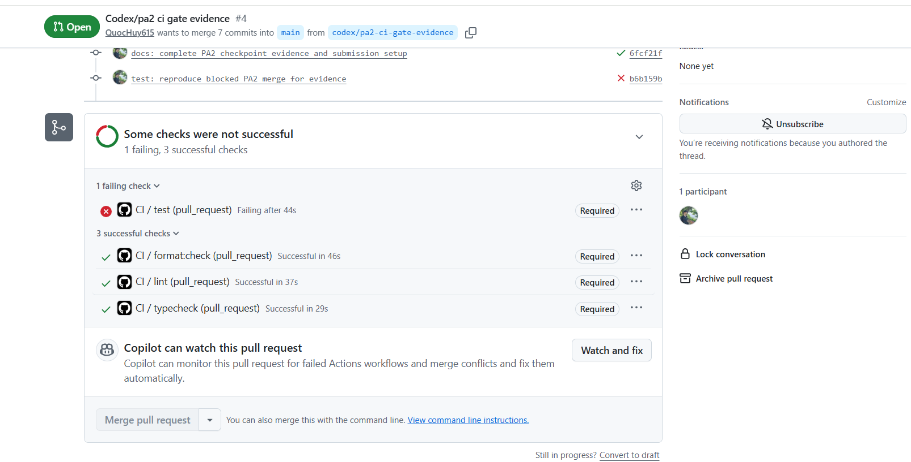

# PA2 CI evidence

- [Public repository](https://github.com/QuocHuy615/Lab-Grader)
- [Protected `main` ruleset](https://github.com/QuocHuy615/Lab-Grader/rules/26621814)
- [CI runs for the `pa2` tag](https://github.com/QuocHuy615/Lab-Grader/actions/workflows/ci.yml?query=branch%3Apa2)

## Merge gate demonstration on PR #4

[PR #4](https://github.com/QuocHuy615/Lab-Grader/pull/4) targets `main`. The [branch rules returned by GitHub](https://api.github.com/repos/QuocHuy615/Lab-Grader/rules/branches/main) require `lint`, `format:check`, `typecheck`, and `test` before merging.

1. [Deliberate regression](https://github.com/QuocHuy615/Lab-Grader/commit/b6b159b74efed74028e02277260ab166d51ec63a) changed the default `pageSize` from `20` to `10` while the contract and tests still expected `20`.
2. The [required test job failed](https://github.com/QuocHuy615/Lab-Grader/actions/runs/42555507719/job/128960188381) and the other three checks passed. The screenshot shows the failed `test` check marked Required and the disabled Merge pull request button.
3. The [repair commit](https://github.com/QuocHuy615/Lab-Grader/commit/9a21a07d97353767b5fd371bfcc0b1aeff3cbe1d) restored `20`. All four required checks passed in the [repair run](https://github.com/QuocHuy615/Lab-Grader/actions/runs/42555765884).

## Earlier red-to-green run on PR #3

[PR #3](https://github.com/QuocHuy615/Lab-Grader/pull/3) also targets `main`.

1. [Deliberate contract break](https://github.com/QuocHuy615/Lab-Grader/commit/40a3d3c5f9ae97f3de54366885c6d3d799ab468f). The commit changed the default `pageSize` from `20` to `10` and left the [API contract](docs/contract/review-queue.md) and tests intact.
2. [Failed test job on PR #3](https://github.com/QuocHuy615/Lab-Grader/actions/runs/42551198590/job/128946958561). Two contract tests expected `20` and received `10`. The other three checks passed. While this commit was the PR head, the GitHub API reported `mergeable_state: unstable`, and the required `test` check was failing. The job log confirms that the workflow checked out `refs/remotes/pull/3/merge`.
3. [Repair commit](https://github.com/QuocHuy615/Lab-Grader/commit/b5415ad68eaa172b7a88a8084ba970430e5b8907). The commit restored the default to `20`.
4. [Passing CI run on PR #3](https://github.com/QuocHuy615/Lab-Grader/actions/runs/42551306978). All four required checks passed on the repair.

The experiment used the failing required check and the PR status as evidence. No merge was attempted during the experiment.

The earlier [trial on PR #2](https://github.com/QuocHuy615/Lab-Grader/actions/runs/42550270328/job/128944057272) targeted `chore/setup-typescript`.
